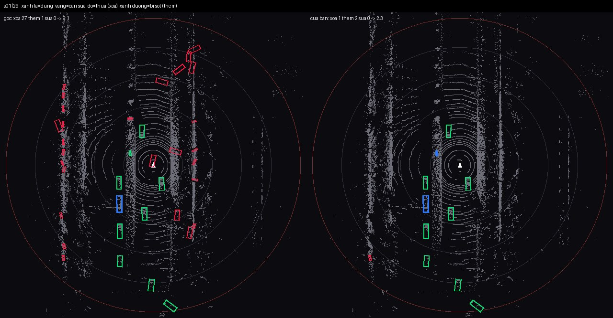

# Báo cáo Day 14 — Nguyễn Hoàn Thiện — 2A202603123

- Mã học viên dùng với `--student`: `123`
- `seed_tag` trong `frames_A.txt`: `393590736f`

## 1. Dự đoán trước sweep (bước 5b)

- **Tham số tôi nghĩ giảm công sửa nhiều nhất:** `score_thr = 0.3` (hoặc `0.4`) và `min_points = 5`.
- **Vì sao (nhìn ảnh BEV tập A: box thừa nhiều hay box sót nhiều?):** Trên ảnh BEV tập A (`s01f29`: 36 box, `s04f25`: 23 box, `s05f21`: 35 box; tổng 94 box pre-label so với 42 box thực tế), lượng **box thừa (`False Positive`) rất nhiều** — đặc biệt là các `Cyclist` ảo ở bụi cây/lề đường (`18` Cyclist ở `s01f29`) và hộp tự đè lên nóc xe ego, trong khi số vật thật bị sót rất ít (`4` hộp). Do đó tăng `score_thr` lên `0.3–0.4` kết hợp `min_points = 5` sẽ cắt mạnh các hộp nhiễu có điểm tin cậy thấp và ít điểm LiDAR, giảm đáng kể công xóa mà chưa làm mất nhiều vật thật.

## 2. Tập A: sửa tay và tune

| Cấu hình | Xóa | Thêm | Sửa | Chi phí |
|---|---:|---:|---:|---:|
| Gốc (`0.1 / 0`) | 56 | 4 | 0 | 20.8 |
| `best_config.json` (`0.5 / 5`) | 6 | 6 | 0 | 7.8 |

- **Tham số đã đổi trong `best_config.json`:** `score_thr: 0.1 -> 0.5`; `min_points: 0 -> 5`.
- **Kết quả leave-one-out:**
  - `s01f29`: cấu hình chọn `{'score_thr': '0.5', 'min_points': '5'}` → `2.3` (tốt nhất có thể `2.3`)
  - `s04f25`: cấu hình chọn `{'score_thr': '0.5', 'min_points': '5'}` → `1.0` (tốt nhất có thể `0.3`)
  - `s05f21`: cấu hình chọn `{'score_thr': '0.5', 'min_points': '5'}` → `4.5` (tốt nhất có thể `4.5`)
- **Cấu hình có ổn định trên từng frame không? Vì sao vẫn chọn nó:** Cấu hình `score_thr = 0.5, min_points = 5` rất ổn định trên `s01f29` và `s05f21` (đạt đúng chi phí tối ưu tuyệt đối, cắt mạnh các hộp nhiễu `Cyclist` ảo), chỉ riêng `s04f25` tăng nhẹ từ `0.3` lên `1.0` do lọc mất 1 hộp thật có `score` dưới `0.5`. Tổng thể vẫn giảm chi phí từ `20.8` xuống `7.8` nên vẫn chọn cấu hình này cho tập B.

## 3. Trước/sau (bước 8)

- `scripts/pp_compare.py` báo **giảm 62%** công sửa trên tập A (`20.8` xuống `7.8`).
- **Dự đoán ở mục 1 đúng hay sai? Giải thích bằng số box xóa/thêm/sửa:** Dự đoán **đúng về xu hướng** (nhận định đúng rằng tập A bị thừa box rất nhiều nên tăng `score_thr` + `min_points = 5` sẽ giảm mạnh công sửa). Thực tế sweep chọn `score_thr = 0.5` (cao hơn mức `0.3–0.4` dự đoán ban đầu) vì ở ngưỡng `0.5`, số hộp cần **xóa** giảm mạnh từ **`56` xuống còn `6`** (tiết kiệm `15.0` điểm chi phí xóa), trong khi số hộp bị sót phải **thêm** chỉ tăng nhẹ từ **`4` lên `6`** (`+2.0` điểm).

## 4. Tập B

Số đo từ `scripts/pp_prelabel.py --frames d14_123/frames_B.txt --config d14_123/best_config.json --gt d14_123/ref_B.json`:

| Xóa | Thêm | Sửa | Chi phí |
|---:|---:|---:|---:|
| 83 | 9 | 19 | 43.4 |

- **Tổng hợp 12 frame Tập B:** GT `113`, dự đoán `187`, khớp `104` (xóa `83`, thêm `9`, sửa `19`).
- **Loại box tốn công sửa nhất ở tập B:** Các hộp `False Positive` (đặc biệt là cụm `Car`/`Cyclist` ảo ở hàng cây, lề đường và ngã tư) phải **xóa (`83` hộp = `24.9` điểm chi phí)** và các xe tải/xe buýt (`Truck`/`Bus`) bị gán nhầm thành `Car` hoặc bị sót hoàn toàn phải **thêm/sửa** kích thước theo Bảng 4.3 (`9` thêm = `9.0`, `19` sửa = `9.5`).

## 5. Giới hạn

- **Tập tune quá nhỏ (chỉ 3 frame Tập A):** Khi phân phối vật thể ở 12 frame Tập B đa dạng hơn (nhiều ngã tư, xe buýt, xe tải), ngưỡng `score_thr = 0.5` tối ưu trên 3 frame A vẫn giữ lại khá nhiều hộp thừa ở lề đường trên Tập B (`83` hộp xóa) nhưng lại bỏ sót một số xe buýt/xe tải (`9` hộp phải thêm).
- **Khoảng cách miền KITTI → VF:** Model PointPillars chỉ học trên KITTI (64 tia, 3 lớp `Car/Pedestrian/Cyclist`, không có `Truck/Bus`), nên trên dữ liệu VF 40 tia vẫn nhầm xe tải/buýt thành `Car` hoặc bỏ sót `Bus` lớn.
- **Chi phí chỉ là công thức xấp xỉ:** Công thức `0.3·xóa + 1.0·thêm + 0.5·sửa` chưa phản ánh hết thời gian thực tế xoay góc nhìn `Top/Side/Front` để căn đáy hộp và hướng đầu xe trên CVAT.

## 6. Dùng AI

- 

